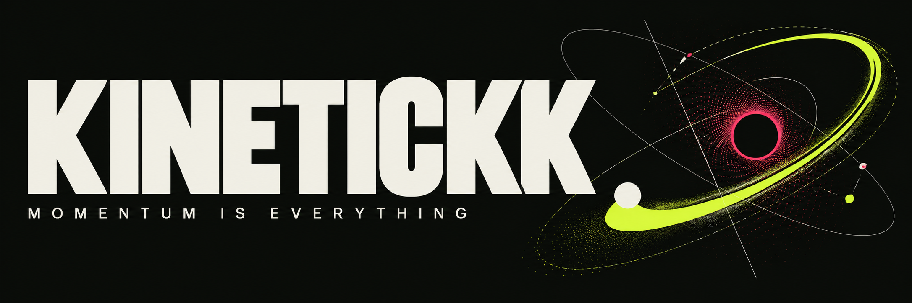

<!-- SPDX-FileCopyrightText: 2026 Vladislav Tomilov -->
<!-- SPDX-License-Identifier: GPL-3.0-or-later -->

  

  <strong>0.6.0 · В разработке</strong> 
  ANDROID &nbsp; / &nbsp; macOS &nbsp; / &nbsp; WINDOWS &nbsp; / &nbsp; LINUX &nbsp; / &nbsp; WEB

<h3 align="center">Движение — твоё оружие.</h3>

  Физический экшен-роглайт: разгоняй ядро, собирай безумные билды и превращай инерцию в урон. 
  Двенадцать минут до Архитектора. Один неверный манёвр до катастрофы.

  <strong>Разломы. Иные миры. Стихийные подземелья.</strong> 
  Реликвии меняют правила. Секреты ждут за пределами знакомой орбиты.

  <a href="https://tomilov.tech/game/"><strong>ИГРАТЬ В БРАУЗЕРЕ ↗</strong></a>
  &nbsp; · &nbsp;
  <a href="https://github.com/4wl2d/KINETICKK/releases">Релизы</a>
  &nbsp; · &nbsp;
  <a href="https://github.com/4wl2d/KINETICKK/issues">Нашёл баг?</a>

  
    Сделал <a href="https://github.com/4wl2d">Vladislav Tomilov</a>
    &nbsp; · &nbsp; <a href="docs/project/DEVELOPMENT.md">Разработка</a>
    &nbsp; · &nbsp; <a href="LICENSE">GPL-3.0-or-later</a>
    &nbsp; · &nbsp; <a href="NOTICE">Уведомления</a>
    &nbsp; · &nbsp; <a href="docs/project/TRADEMARKS.md">Бренд</a>
  

