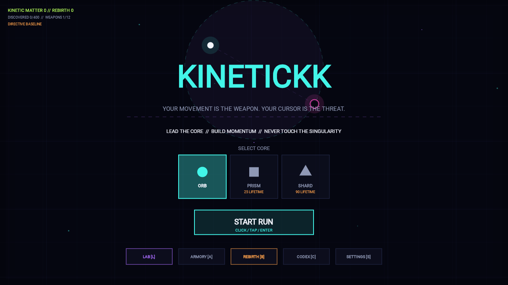

<!-- SPDX-FileCopyrightText: 2026 Vladislav Tomilov -->
<!-- SPDX-License-Identifier: GPL-3.0-or-later -->

# KINETICKK

**Your movement is the weapon. Your cursor is the threat.**

A physics-action roguelite for Android, desktop (macOS, Windows, Linux), and
WebAssembly, built with Kotlin Multiplatform and Compose.



Steer a magnetic singularity to accelerate your Core and turn momentum into
impact damage. Keep the Core away from the singularity, build a loadout, and
survive twelve minutes to face **The Architect**.

## How to play

Pull the cursor away from the Core to gain speed. The Core flies like a craft
you pilot: it grips in turns, carving a curve adds speed instead of bleeding
it, a launch from rest spools up quickly, and long straight runs slowly add
drag. Staying at the screen edges drains Magnetic Polarity; return inward,
turn, or brake to recover. Fresh profiles start at 1× speed. Pauses and reward
choices stop the run clock. The Core's trail follows the path it flew.

Space is full of asteroids: a slow touch is harmless, a fast hit hurts even at
a glance and partly through shields, and ramming one at full speed shatters
the Core. Bumpers throw you back, crystals shatter into shards and Data,
accelerator gates and thermal vents boost you, gravity knots pull you in or
push you away, derelict mines arm as you pass and go off, and phase shards are
solid only part of the time. The minimap (Settings can hide it) shows what lies
ahead. Data pickups latch on once you pass near them and every level-up pulls
in the Data on screen.

Data levels the run up to level 42, and only a build that invests in Data gets
there. Eighteen items are active: on top of a small passive bonus, each puts an
effect in slot Z, X or C that you cast yourself. Item offers show them rarely,
at most one per offer and none in the first levels, and favour your character's
own three; taking one again raises it to rank II, then III. With all three
slots full, a new active replaces the one you pick, or you keep your loadout
and salvage the new one for Matter. At level 42 your character's Apex ability
comes online; after that every Data pickup shortens its cooldown. The level
badge changes look at levels 10, 20, 30 and 40 and takes the Apex look at 42.

| Input | Action |
|---|---|
| Mouse / touch drag | Move the singularity and attract the Core |
| `Space` / **Dash** | Kinetic Dash and phase through bullets |
| `Shift` / right mouse / **Brake** | Gravity Brake |
| `Z` / `X` / `C`, active buttons | Cast the active effect in slot 1, 2 or 3 |
| `V`, level badge | Cast the Apex ability (from level 42) |
| `P` / `Esc` | Pause or return |
| `1`–`4` | Select a reward |
| `Q` | Reroll an item, weapon or Relic choice |
| `W` | Workshop: characters, weapons and the Core Matrix |
| `L` / `A` / `H` | Workshop on the Core Matrix, Weapons or Characters tab (`H` from Home) |
| `B` / `C` or `I` / `S` | Rebirth, Codex, Settings |
| `E` | Toggle Baby mode on Home |
| `M` | Toggle sound and music |
| `F3` | Toggle and reset the performance HUD |
| `R` | Restart after a completed run |

With a keyboard, Settings → Controls rebinds every gameplay action (Dash,
Brake, the three actives, the Apex, pause, reroll, restart, the four reward
choices and the performance HUD); binding a key another action holds swaps the
two, and Reset restores the defaults above. While a run is running, keys bound
to gameplay actions go to the run first, so `C` casts the third active there
and opens the Codex from Home or the pause menu. On touch screens the active
buttons sit next to Dash and Brake in every layout, and steering keeps working
while you tap them.

Twelve characters, chosen in the Workshop, each play a mechanic of their own
(facets, an echo ghost, polarity, a beat, Blink and more), each have their own
Apex ability and can use all twenty-four weapons: trails, orbitals, auras,
projectiles, traps, chains, beams and pulses, sixteen open to Matter from the
start and eight that also need a Reborn rank. Weapons link to the build: each
point in the weapon's two tags adds 5 % power (up to 50 %); its signature
character (every character is the signature of two weapons) adds 20 %, starts
the run a weapon level up and brings a twist; a bound Relic carrying the
weapon's key (the heirloom included) adds 20 % once and grows 10 % stronger
itself; one stat scales it, and three mastery forms open at weapon levels 3, 6
and 10. Builds combine 302 items (eighteen active and fifteen built around the
obstacle kinds), twenty-two Relics and the optional sites below. Items are
rules, not stat sticks: triggers, conditions and effects over nine archetype
tags and seven elements (Thermal, Cryo, Ion, Gravitic, Entropy, Sonic, Void)
whose statuses Break at a threshold and react with each other: every pair of
elements has its own reaction, 21 in all, and each reaction changes how you
play (it leaves a field, a mark, a Core state or a cooldown refund for your
actives) with a keystone item that rewrites it.
Every run deals its own draft deck, and items you took in recent runs come up
less often, so runs of one character build differently. Every Relic rewrites a
rule and carries a cost; Relic keys predict harmony and dissonance, and the
Codex records discovered reactions, pairings and known incompatibilities,
tells you which items wait for an active item or were left out of this run's
deck, and keeps the places and secrets you have found under World.
Thirty-five enemy kinds, from Swarmling packs and Bombers to five mini-bosses
and two secret bosses, fill space, the ruins and the other layers; later
Rebirth tiers bring the toughest ones. Between runs, spend
Kinetic Matter in the Workshop: on the 32 nodes of the Core Matrix, on weapons,
and on Refit (per character) and Honing (per weapon) levels up to 10, each
level twice the price of the last. You can open the Workshop during a run too;
purchases apply from the next run. Defeat The Architect to earn the next
Rebirth tier and a Reborn rank while keeping permanent progression. The Rebirth
ladder shows tiers 0 to 10 and what each rank opens: at least four more items
every rank, a weapon at ranks 1 to 7 and 9 (Glacier Bell first, Resonance Drum
last), the Spiral, Pentagon, Crescent and Hexagon at ranks 1, 3, 5 and 7,
Matrix nodes and the enemy kinds that join at that tier. Each tier is much
harder and adds a mutator (packs, hardened Elites, volatile remains, armored
vanguards, a blackout and an enraged Architect among them), and you can pick
any earned tier for the next run, so a hard tier never locks you out. Clearing
tier 10 makes you Ascendant.

No two runs open alike. At the start a run offers three of twelve omens, each a
bonus with a cost, or No omen. The spawn director plays one of six
personalities, from Tidewave to Long Calm, named on the HOSTILE PATTERN banner,
and every surge features one ONSLAUGHT kind. Each run draws a Keynote tag and
element that its deck leans on. From two minutes in, Elites can carry one of
six affixes (Shielded, Splitting, Magnetic, Linked, Volatile or Hasted), and
ordinary enemies may arrive as tougher champions that carry more Matter and
Data. Two or three world events sweep the field: meteor showers, Data, gravity
and ion storms, and solar flares. Event signals call you to a Merchant, a
Shrine, a Gamble, a Cursed cache or a Derelict, each a trade you may take or
fly past.

Site windows offer two sites at a time: the anomaly trials, gate races against
a gold, silver and bronze par, five challenges (Brakeless run, Ram rite,
Untouched, Velocity hold and Slalom), bounty arenas where a marked mini-boss
waits, and rifts into other layers. Drift caches float far from the start,
easter eggs hide across the field, and a far sigil, found only by flying very
far very early, summons the Cartographer, a secret boss. Ruins stand at least
4,000 units from the start: a Derelict Station, Vault, Spire, Labyrinth,
Foundry or Reliquary whose doors seal behind you, with rooms of guards, inner
doors that open as you clear them and a final room that pays in Relics, Keys,
items, Matter, Data or repairs. Rifts lead to the Zenith, a layer of light
where grace lightens the Core and Blessings wait for those who finish an Ascent
through halo gates or a Judgement against the Throne, and to the Nadir, a
furnace where slow flight scorches, Matter burns twice as bright, the trial is
a Harvest of embers or a fight with the Pyre Herald and Pacts are offered at a
price. Finish both in one run, or find the quiet signal, and a glitch rift
opens into the Archive, the Architect's memory, where time moves only when you
move and the Antecedent waits. Every layer lets you go before the Architect
arrives.

Baby mode, switched on Home, is the joke easy mode: the cursor turns green and
bounces the Core away instead of killing it, incoming damage is halved and
rocks never finish you off. Nothing is counted: no Matter, Rank, Codex entries,
unlocks or achievements.

The game has six screens: Home, the run, Settings, the Workshop, Rebirth and the
Codex. Settings groups its options into Game, Sound, Display, Graphics,
Interface and Controls. Display chooses the window mode (windowed, borderless or
fullscreen), the window size and V-Sync on desktop, the refresh rate and hidden
system bars on Android and fullscreen in the browser, and a frame-rate limit
everywhere; Interface scales menus and the HUD from 85 to 130 %; Graphics sets
how much of each reaction is animated. Show FPS adds a frame counter to the HUD,
and the run pauses when the window loses focus unless you turn that off.

## Build and run

Requires JDK 17 or newer; Android builds also need the Android SDK.
The Gradle wrapper downloads Gradle and the project dependencies.
On Windows, replace `./gradlew` with `gradlew.bat`.

```bash
./gradlew :app:desktop:run
./gradlew :app:web:wasmJsBrowserDevelopmentRun
./gradlew :app:android:assembleDebug
```

### Frame rate

The simulation runs at a fixed 120 steps per second in density-independent
units, and frames between steps draw interpolated positions, so the game is the
same at any frame rate and any display density. With V-Sync the desktop frame
rate follows the monitor (a 144 or 240 Hz display already renders above
120 fps); Android uses the refresh rate chosen in Settings, and Auto asks for
the panel's highest. Settings can turn V-Sync off and limit the frame rate; the
uncapped launch mode below turns V-Sync off whatever Settings stores:

```bash
./gradlew :app:desktop:run -Pkinetickk.uncapped=true
KINETICKK_UNCAPPED_FPS=1 ./gradlew :app:desktop:run
```

A packaged desktop build takes `-Dkinetickk.uncapped=true` or the same
environment variable. Below 10 fps a frame advances at most 0.1 s of game time,
so the game slows down instead of skipping physics (a spiral-of-death guard).
`F3` shows the measured frame rate.

The Android debug APK is in `app/android/build/outputs/apk/debug/` and uses a
separate package from the release. Build the production web bundle with
`./gradlew :app:web:wasmJsBrowserDistribution`; its output is
`app/web/build/dist/wasmJs/productionExecutable/`.

### Automatic web releases

[Publish web release](.github/workflows/web-release.yml) builds and tests the
latest stable GitHub release, then attaches its browser files and
`kinetickk-web.json` to that release. The game at
[tomilov.tech/game/](https://tomilov.tech/game/) picks up the ready build
automatically, without republishing the portfolio. Prereleases are excluded.
The workflow runs on release publication and edits, checks hourly for missed
updates, and can be started manually with **Run workflow**.

Files are verified before the readiness manifest is uploaded. Published web
builds are never overwritten; use a new release tag to change the game. Tags
must be 1–64 letters, digits, dots, underscores or hyphens, beginning with a
letter or digit. GitHub release immutability must remain off until the build
assets have been attached. Only the publication job needs `contents: write`;
no personal token or Sites credential is needed in GitHub Actions.

The site keeps each session on a fixed release URL under the same origin and
checks for a newer ready release at most once a minute per active server
instance. During a build or GitHub outage it serves the last successful build
available to that instance, with the bundled build as a fallback. Existing
sessions continue on their selected release; reopen the game to update.

### Verification

```bash
./gradlew desktopTest
./gradlew :app:android:assembleDebug :app:android:assembleDebugAndroidTest :app:shared:assembleAndroidDeviceTest
CHROME_BIN=/path/to/chrome ./gradlew wasmJsBrowserTest wasmJsBrowserDistribution --max-workers=1
```

Without switches, `desktopTest` runs the screenshot harnesses (`RedesignShots*`
and the before/after captures) as smokes that render every screen state at least
once (the World marker flights only in part) without writing files, renders one
reward card gallery sheet per card kind, and samples the longest allocation and
layout sweeps. `KK_SHOTS=1` renders the full size and language matrix of the
`RedesignShots*` harnesses to PNGs under each module's `build/redesign-shots/`
(or `KK_SHOTS_OUT` where a harness reads it). The card gallery writes only when
`KK_SHOTS_OUT` names a folder, and the before/after captures only into `KK_BA_DIR`.
`KK_FULL_SWEEPS=1` runs every sweep in full.

`./gradlew verifyArchitecture` checks the module dependency graph.

CI splits `desktopTest` into parallel shards. `-Pkinetickk.desktopTest.shard=gates-1`
(through the last `gates-N`) runs one shard of the seeded balance gates, and `rest`
runs every class that no gate shard lists. The lists live in build-logic's
`DesktopTestShard`. Without the property, `desktopTest` runs every class.

[CI](.github/workflows/ci.yml) defines the complete platform checks.
[Performance tools](tools/performance/README.md) cover benchmark comparisons.
Agent instructions are in [AGENTS.md](AGENTS.md).

### Crash reports

Desktop reports stay in `~/.kinetickk/crashes/`
(`%USERPROFILE%\.kinetickk\crashes` on Windows). The crash dialog can open
that folder; `bash tools/crashes/latest.sh --path` prints the latest report path.
Reports include logs, runtime details, and diagnostic copies of saves. Nothing
is uploaded. See the [privacy note](docs/project/PRIVACY.md).

## Status

Version **0.6.0** is a playable prototype. It adds the piloted flight, six
obstacle kinds and harsher fast impacts, the path-following Core trail, sites
(races, challenges, bounties, caches, easter eggs and the secret sigil),
mini-bosses and secret bosses, structures and dungeons far from the start, the
Zenith, Nadir and Archive, run omens, director personalities, Elite affixes and
champions, world events and event signals, and Baby mode. A 0.5.0 profile
carries over as it is. Before 1.0.0, only the current profile schema is
supported: incompatible profiles start from defaults, and older save locations
remain untouched. Balance, content, and save formats may change during
development.

## Contributing

Bug reports and focused pull requests are welcome. Describe the change and the
checks you ran; include comparable performance results for hot-path changes.
Follow the existing code and retain regression tests. Identify the source and
license of copied, generated, or adapted material. New project-authored files
use an accurate SPDX copyright line and `GPL-3.0-or-later` license identifier.

Contributions use GPL-3.0-or-later. Contributors keep their copyright and must
have the right to submit the material. No separate CLA or DCO sign-off is required.

## License

Copyright © 2026 Vladislav Tomilov. Licensed under
[GNU GPL version 3 or later](LICENSE). See [NOTICE](NOTICE),
[authors](docs/project/AUTHORS.md),
[third-party notices](docs/project/THIRD_PARTY_NOTICES.md),
[asset provenance](docs/project/ASSET_PROVENANCE.md), and
[corresponding source](docs/project/SOURCE.md).
The KINETICKK name and branding have a separate
[trademark policy](docs/project/TRADEMARKS.md).
